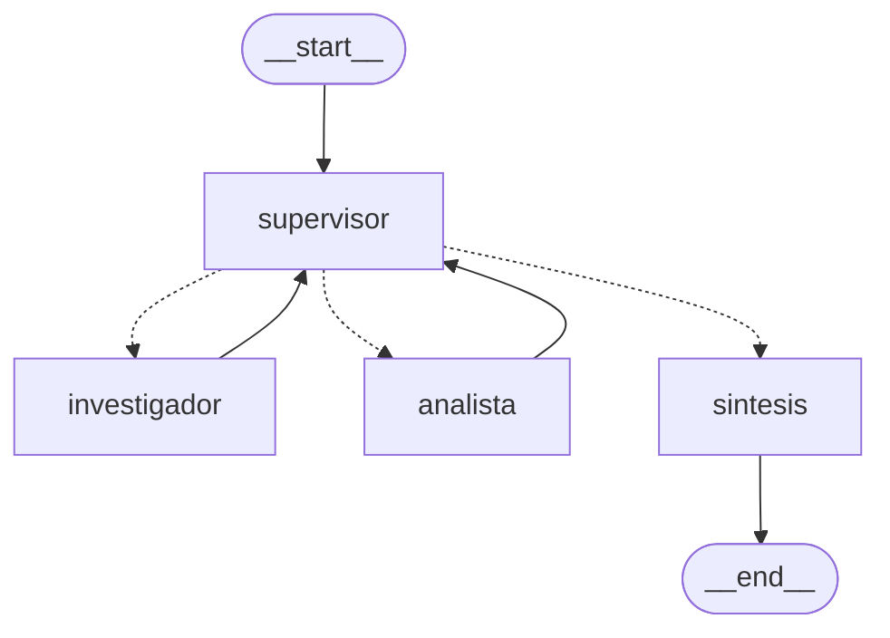
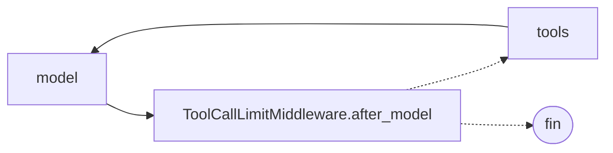

# Pre-entrega 6: Orquestador multi-agente especializado

**Curso AI Engineering - CoderHouse** | Juan Sebastián Perez - Comisión 102130

Prototipo de un **orquestador multi-agente de análisis e investigación** sobre normativa del **Banco Central de
la República Argentina (BCRA)**, construido con **LangGraph**. Un **Supervisor** recibe la consulta, delega en
dos especialistas, valida lo que producen con una rúbrica y, cuando el trabajo es suficiente, pasa a una fase de
**síntesis** que redacta la respuesta final.

| Rol | Especialidad | Herramientas (acotadas al rol) |
|---|---|---|
| **Supervisor** | router + control de flujo + validación | ninguna: decide con salida estructurada |
| **Investigador** | búsqueda en la normativa (Vector DB de la PE4/PE5: Pinecone + BM25) | `buscar_normativa`, `leer_punto` |
| **Analista** | cómputo financiero según t-tasint (TEA, cuota, CFT) | `convertir_tasa`, `simular_prestamo`, `calcular_cft_flujos` |
| **Síntesis** | redacción final a partir de las contribuciones | ninguna |

**Demo del flujo de delegación: [`demo.ipynb`](demo.ipynb)** (ejecutado, con las salidas guardadas).

## Diagrama del grafo

Generado con `graph.get_graph().draw_mermaid()` (`python graph.py --mermaid`). Las flechas punteadas son las
aristas condicionales del supervisor.



Dentro de cada especialista hay otro ciclo ReAct (modelo ⇄ herramientas), creado con `create_agent`:



## Por qué una topología jerárquica

- **El pedido tiene dependencias**: para calcular un CFT, primero hay que saber qué conceptos son computables
  según la norma. Un supervisor puede **ordenar** el trabajo (investigador → analista) y pasarle al analista lo
  que encontró el investigador. En una cadena fija, ese orden quedaría cableado para un único tipo de pregunta.
- **Validación centralizada**: un solo nodo ve todas las contribuciones y puede aplicar la rúbrica sobre el
  conjunto, por ejemplo la coherencia entre lo que dice la norma y lo que se calculó.
- **Flexibilidad**: el supervisor puede saltear especialistas si no hacen falta (pregunta ajena → síntesis directa),
  repetir uno para refinar o invertir el orden. Lo decide el LLM, sin if/else.
- **Alternativas descartadas**:
  - *Red* (cada agente llama a cualquier otro): más difícil de acotar y de depurar.
  - *Secuencial fija*: no permite refinar ni saltear pasos.
  - *Supervisor jerárquico de varios niveles*: excesivo para dos especialistas.

## Estado compartido (`state.py`)

```python
class EstadoOrquestador(MessagesState):
    contribuciones: Annotated[list[Contribucion], operator.add]       # QUIÉN aportó QUÉ (agente, ronda, tarea, resultado, herramientas)
    decisiones:     Annotated[list[DecisionSupervisor], operator.add]  # cada ruteo del supervisor con su motivo
    siguiente:      Literal["investigador", "analista", "sintesis"]    # lo lee la arista condicional
    instruccion:    str      # tarea vigente para el especialista
    delegaciones:   int      # contador anti "supervisor infinito"
    tarea_completa: bool     # True si cerró por la rúbrica; False si cerró por el contador
```

- `messages` (de `MessagesState`) es **solo la conversación con el usuario**: pregunta y respuesta final.
- Los aportes de los agentes van a campos **estructurados y atribuidos**. El supervisor y la síntesis
  trabajan sobre `contribuciones`, no sobre un chat mezclado. Eso evita perder contexto entre agentes y deja la
  traza de delegación en el propio estado (ver la sección 2.1 de la demo).
- Los campos con `operator.add` se acumulan (cada nodo devuelve solo lo nuevo); el resto se sobrescribe.

## Supervisor y validación (`agents/supervisor.py`)

El supervisor decide con **salida estructurada** (Pydantic):

```python
class Decision(BaseModel):
    evaluacion: str                                            # la rúbrica aplicada (se escribe ANTES de elegir)
    destino: Literal["investigador", "analista", "sintesis"]
    instruccion: str                                           # tarea autocontenida para el especialista
    motivo: str
```

y la arista condicional `rutear()` devuelve `Literal["investigador", "analista", "sintesis"]`, que es el nombre
del nodo. Antes de ir a `sintesis`, el supervisor aplica una **rúbrica** de 5 criterios:

1. **Cobertura**: cada parte del pedido está respondida.
2. **Fundamento**: las afirmaciones normativas vienen del investigador y citan doc_id y punto.
3. **Cifras**: todo número viene del analista y el analista usó una herramienta de cálculo.
4. **Coherencia**: los conceptos incluidos o excluidos del cálculo coinciden con lo que encontró el investigador.
5. **Supuestos**: todo supuesto que no dio el usuario es un valor por defecto de la herramienta o tiene fuente.

Si algo falla, devuelve el trabajo con una instrucción de **refinamiento** que dice qué corregir.

### Cómo se manejan los conflictos entre agentes

- **Norma vs. cálculo**: si el analista incluyó o excluyó un concepto distinto de lo que dice el investigador,
  **manda la norma**: se refina al analista. En una corrida de prueba, el supervisor detectó que el analista había
  sumado el IVA y, antes de cerrar, mandó al investigador a confirmar que era computable (t-tasint 3.4.2.7).
- **Instrucción vs. norma**: si la tarea le pide al analista un parámetro que contradice la normativa (por ejemplo
  divisor 360 en un préstamo personal), el analista usa el correcto y lo declara en SUPUESTOS.
- **Especialista que no puede**: si informa que algo **no está en la normativa** o que **falta un dato** que el
  usuario no dio, el supervisor no insiste. Va a síntesis y la respuesta lo aclara.
- **Información solo de herramientas**: cada especialista tiene prohibido completar con conocimiento propio. Los
  números salen siempre de `tools/finanzas.py`, que implementa las fórmulas oficiales de t-tasint 3.3.

### Condiciones de parada (anti "supervisor infinito")

| Nivel | Mecanismo |
|---|---|
| Supervisor | criterio de **suficiencia** (rúbrica) + contador duro `MAX_DELEGACIONES = 5`: al llegar, va a síntesis sin consultar al LLM y marca `tarea_completa = False` |
| Grafo externo | `recursion_limit = 25` |
| Cada especialista | `ToolCallLimitMiddleware(run_limit=8)` + `recursion_limit = 40` en su ciclo interno |
| Repeticiones | el supervisor ve su historial de decisiones y tiene prohibido repetir una instrucción con el mismo resultado |

### Contaminación de contexto

- Cada especialista recibe **solo** su `TAREA` y el `CONTEXTO` con los **resultados** de otros especialistas. No ve
  la conversación con el usuario, ni las trazas internas de herramientas, ni las decisiones del supervisor
  (`agents/base.py → armar_mensaje`).
- Por eso la instrucción del supervisor tiene que ser **autocontenida**, con todos los datos del caso.
- Cada especialista corre en un hilo efímero, sin memoria propia, así que no arrastra estado de tareas anteriores.

## Herramientas

**Investigador** (`tools/normativa.py`, de la PE5): `buscar_normativa` (híbrido BM25 0.3 + vectorial 0.7,
umbral 0.40) y `leer_punto` (texto completo de un punto por clave exacta). Los errores vuelven como datos
(`sin_resultados_relevantes`, `punto_inexistente`) con una sugerencia para reintentar.

**Analista** (`tools/finanzas.py`, nuevas): implementan la norma *Tasas de interés en las operaciones de crédito*.
- `convertir_tasa`: TNA → TEA con 3.3.1 (intereses vencidos) o 3.3.2 (adelantados): `i = [(1 + is·m/(df·100))^(df/m) − 1]·100`.
- `simular_prestamo`: sistema francés, TEA y **CFT** (3.4.1) como TIR de los flujos del cliente anualizada. Devuelve el desglose de cuánto suma cada concepto.
- `calcular_cft_flujos`: CFT a partir de flujos arbitrarios.

Las fórmulas del punto 3.3 son **imágenes** en el PDF del BCRA, así que no están en la base vectorial: el
investigador no puede traerlas y el LLM las reconstruiría de memoria. Por eso el cálculo es determinístico.
`python -m tools.finanzas` las verifica contra casos calculados a mano, por ejemplo el CFT sin gastos = TEA y
el pago único con comisión.

## Cómo levantar el entorno

Requisitos: **Python 3.12**, una API key de OpenAI y el índice de Pinecone de la PE4/PE5 (si no existe, se crea).

```bash
py -3.12 -m venv .venv                 # Linux/macOS: python3.12 -m venv .venv
.venv\Scripts\activate                 # Linux/macOS: source .venv/bin/activate
pip install -r requirements.txt

copy .env.example .env                 # Linux/macOS: cp .env.example .env
#    completar PINECONE_API_KEY, OPENAI_API_KEY y LLM_PROVIDER (las keys NO están en el repo)

python ingest.py                       # solo la primera vez: carga el índice (si ya existe, no hace nada)
```

## Uso

```bash
python graph.py                        # consulta de demo: préstamo (normativa + CFT + cómo informarlo)
python graph.py "tu consulta"
python graph.py --mermaid              # diagrama Mermaid del grafo

# Cada pieza por separado
python -m tools.finanzas               # herramientas del analista vs. cálculos a mano
python -m tools.normativa              # herramientas del investigador
python -m agents.research_agent "¿Qué conceptos se incluyen en el CFT?"
python -m agents.analyst_agent         # analista con contexto simulado (caso completo y caso sin datos)

jupyter notebook demo.ipynb            # demo del flujo de delegación
```

## Ejemplo del flujo (de `demo.ipynb`)

```
[supervisor · ronda 1] → INVESTIGADOR  (Primero hace falta establecer, con fuente normativa, qué cargos integrarían el CFT...)
[investigador] herramientas: buscar_normativa, leer_punto, ..., leer_punto
    HALLAZGOS: comisión (3.4.1), seguro exigido (3.4.2.3), IVA s/ intereses para consumidor final (3.4.2.7) ...
[supervisor · ronda 2] → ANALISTA      (El investigador ya aportó el fundamento normativo y ahora hace falta el cálculo...)
[analista] herramientas: simular_prestamo
    CFT 123,88% · TEA 79,62% · desglose: intereses 79,62 → +comisión 91,27 → +seguro 98,41 → +IVA 123,88
[supervisor · ronda 3] → ANALISTA      (Hay supuestos de cálculo no justificados como valores por defecto... → REFINAMIENTO)
[analista] herramientas: simular_prestamo
    mismo CFT, ahora con todos los valores por defecto declarados
[supervisor · ronda 4] → SINTESIS      (Las contribuciones cubren las tres partes del pedido y cumplen ... la rúbrica)
[sintesis] RESPUESTA FINAL: conceptos del CFT con fuentes, CFT 123,88% con supuestos, cómo debe informarse
```

La demo también incluye:
- la verificación de que el CFT de la respuesta coincide con el que calcula la herramienta sin LLM,
- una pregunta ajena al dominio (0 delegaciones),
- un caso con datos faltantes (el analista informa qué falta y el supervisor cierra sin insistir).

## Hallazgos durante el desarrollo

1. **Límites que destruían el trabajo.** En la primera prueba, el investigador hizo 8 llamadas y chocó con
   `ToolCallLimitMiddleware(exit_behavior="end")`, que **termina sin dejar redactar**: se perdía todo lo leído.
   Además, `recursion_limit=12` alcanzaba para solo 4 vueltas, porque el middleware agrega un nodo
   (`ToolCallLimitMiddleware.after_model`) y cada vuelta usa 3 pasos. Lo corregí con `exit_behavior="continue"`
   (bloquea las llamadas extra como error y deja cerrar), `recursion_limit=40`, y recuperando el trabajo parcial
   si igual se corta. Aun con la falla, el supervisor dejó de insistir y la síntesis no inventó nada: las redes
   de seguridad funcionaron.
2. **El supervisor "contaminaba" la tarea.** Le pidió al analista calcular con "tasa mensual = TNA/12", que
   equivale a divisor 360 y contradice t-tasint 1.5.1 (365 salvo hipotecarios y prendarios). Resultado: CFT
   123,51% en lugar de **123,88%**. Corregido en tres capas: el supervisor no agrega supuestos técnicos, el
   analista corrige parámetros contrarios a la norma y los declara, y la rúbrica suma el criterio 5 (supuestos).
3. **`create_react_agent` está deprecado** en LangGraph 1.x. Uso su reemplazo oficial,
   `langchain.agents.create_agent`, y su **middleware** para el guardrail de la PE5: mientras el especialista no
   usó ninguna herramienta, se fuerza `tool_choice="any"`.

### Limitaciones conocidas
- Por el guardrail, un especialista sin datos suficientes igual hace una llamada antes de informar lo que
  falta (por ejemplo, `simular_prestamo` con capital 0). Es inofensiva: vuelve como `datos_invalidos`.
- La lista `herramientas` de una contribución incluye las llamadas que `ToolCallLimitMiddleware` bloqueó, por
  eso puede mostrar más de 8.
- El criterio 5 de la rúbrica hace al supervisor más exigente: a veces pide un refinamiento que solo agrega
  aclaraciones (como en la demo). Cuesta una delegación más y la cifra no cambia.
- Sin memoria entre consultas: cada pedido arranca un estado nuevo. La persistencia por `thread_id` fue el foco
  de la PE5 y se podría sumar con un checkpointer en `compile()`.

## Estructura

```
├── state.py                  # EstadoOrquestador, Contribucion, DecisionSupervisor
├── graph.py                  # StateGraph: nodos, aristas condicionales (Literal), síntesis, ejecutar()
├── agents/
│   ├── base.py               # create_agent + middleware (guardrail, límite de tools), ejecución aislada
│   ├── research_agent.py     # Investigador
│   ├── analyst_agent.py      # Analista
│   └── supervisor.py         # Supervisor: rúbrica, salida estructurada, contador de delegaciones
├── tools/
│   ├── normativa.py          # buscar_normativa, leer_punto (PE5)
│   └── finanzas.py           # convertir_tasa, simular_prestamo, calcular_cft_flujos (t-tasint 3.3/3.4)
├── llm.py                    # configuración del LLM por .env
├── demo.ipynb                # demo del flujo de delegación (ejecutado)
├── rag_system.py, ingest.py, setup_index.py   # RAG híbrido de la PE4
├── data/                     # textos ordenados del BCRA en Markdown
├── requirements.txt
└── .env.example
```

## Checklist de la consigna

| Requisito | Cómo se cumple |
|---|---|
| Topología jerárquica con Supervisor | `supervisor` → aristas condicionales → especialistas → `supervisor` |
| ≥ 2 especialistas: búsqueda y análisis/cómputo | `agents/research_agent.py` (Vector DB) y `agents/analyst_agent.py` (cálculos financieros) |
| Herramientas acotadas por agente | investigador: solo normativa; analista: solo cálculo |
| Estado compartido estructurado que rastrea contribuciones | `state.py`: `contribuciones` y `decisiones` atribuidas por agente y ronda |
| `TypedDict` que hereda de `MessagesState` (+ `next_agent` / `task_completed`) | `EstadoOrquestador(MessagesState)` con `siguiente` y `tarea_completa` |
| Especialistas con `create_react_agent` o prompts por rol | `create_agent` (reemplazo oficial) + prompt específico por rol |
| Supervisor decide con `Literal` en las aristas condicionales | `Decision.destino` y `rutear() -> Literal[...]` |
| Supervisor decide si refinar o finalizar / validación | rúbrica de 5 criterios + instrucciones de refinamiento |
| Fase de síntesis final | nodo `sintesis` |
| Condición de parada / evitar el supervisor infinito | `MAX_DELEGACIONES = 5`, `recursion_limit`, límites por especialista |
| Evitar la contaminación de contexto | especialistas con TAREA + CONTEXTO mínimo (`armar_mensaje`) |
| README con diagrama del grafo, topología y conflictos | este archivo |
| Video o notebook con el flujo de delegación | `demo.ipynb` |
| Sin API keys en el repo | `.env` en `.gitignore`, `.env.example` como plantilla |
